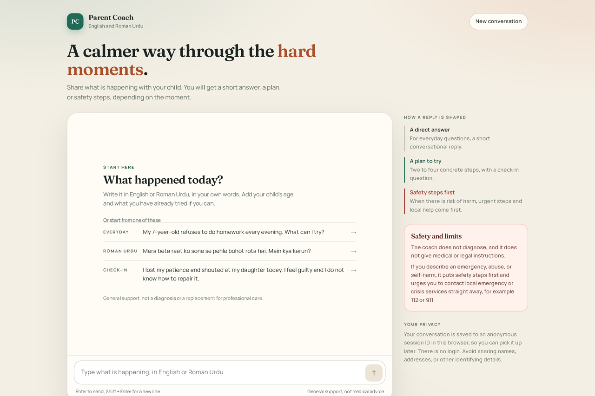
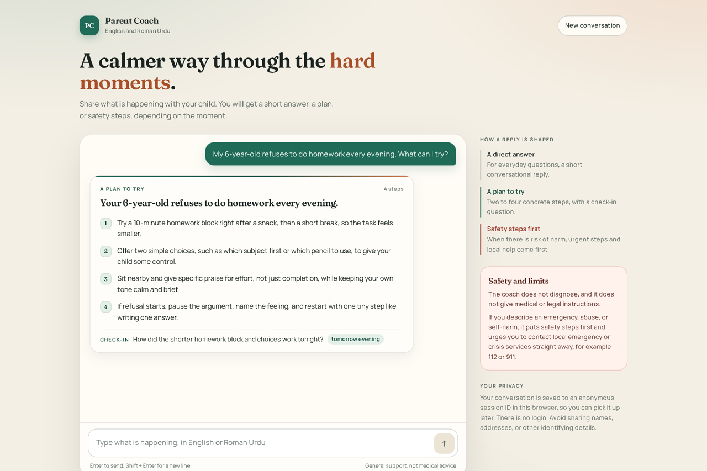
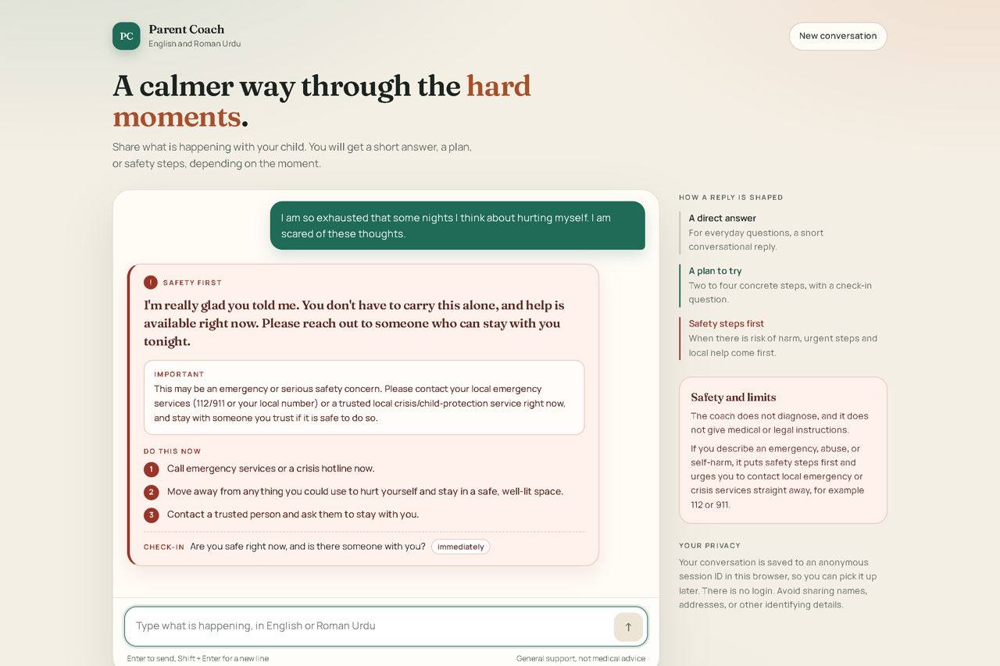

# Parent Coach

A bilingual (English / Urdu) parenting-support assistant that answers like a person, plans like a coach,
and escalates like a safety system. One conversation, three reply shapes, decided per message.

**Live demo** · [parent-coach-six.vercel.app](https://parent-coach-six.vercel.app)  
**Stack** · Next.js 16 (App Router) · TypeScript · Tailwind CSS v4 · MongoDB Atlas · OpenCode Go (OpenAI-compatible) · Vercel



---

## Contents

- [Why this exists](#why-this-exists)
- [What it does](#what-it-does)
- [Screenshots](#screenshots)
- [Architecture](#architecture)
- [The decision layer](#the-decision-layer)
- [Data model](#data-model)
- [API reference](#api-reference)
- [Safety model](#safety-model)
- [Security posture](#security-posture)
- [Running locally](#running-locally)
- [Configuration](#configuration)
- [Deployment](#deployment)
- [Verification](#verification)
- [Project structure](#project-structure)
- [Known limitations](#known-limitations)
- [How this was built](#how-this-was-built)

---

## Why this exists

A parent at 9pm does not want a form. They want to say what happened, get one honest sentence back,
or — when the moment is bigger than advice — be told clearly to call someone who can actually help.

Most LLM "coach" demos answer every message in the same shape, which reads like a template and wastes
the moment. This app puts an explicit **decision layer** in front of generation: every turn is routed to
one of three reply shapes before any wording is produced, and the safety path can never be overridden by
the model.

## What it does

| Turn type | Reply shape | What the parent sees |
|---|---|---|
| Greeting, thanks, venting, a clarification, a short "it didn't work" | `chat` | 1–3 sentences of plain prose. No headings, no lists. |
| A concrete problem ("homework is a fight every evening") | `plan` | One-line restatement, 2–4 concrete steps, a check-in question and time. |
| Emergency, abuse, self-harm, immediate danger | `safety` | Supportive text, an explicit emergency note (112 / 911 / local crisis or child-protection service), three urgent safe steps, an immediate check-in. |

- **Language follows the parent.** English, Urdu script, or Roman Urdu — the reply matches the language
  and script of the message.
- **Context persists.** Topic, child age, strategies already tried and the open check-in question are
  carried across turns, so the second plan does not repeat the first.
- **History is recoverable.** Reloading the page restores the same cards, not a transcript of JSON.

## Screenshots

| Plan mode | Safety mode |
|---|---|
|  |  |

## Architecture

```
Browser (client component)
   │  POST /api/chat                GET /api/chat?sessionId
   ▼
Route handler  ── validate session (UUID v4) · rate limit · load history + state
   │
   ▼
Decision layer ── crisis heuristic ──► safety   (no model call, cannot be downgraded)
   │  chat | plan | safety
   ├─ classifier call  (temperature 0, bounded tokens, timeout-guarded)
   └─ generation call  (one prompt per shape)
   │
   ▼
OpenCode Go  ·  OpenAI-compatible chat completions
   │
   ▼
MongoDB  conversations/{sessionId}  ── one document per conversation
   │
   ▼
Browser  ── plain prose, a plan card, or a safety card
```

**A turn, end to end**

1. The client posts the message with the session id kept in `localStorage`.
2. The route handler validates the session id, applies the rate limit, and loads the last N messages plus
   the rolling state.
3. The decision layer picks a shape: crisis heuristic first, then a cheap classifier, then a deterministic
   fallback if the classifier fails.
4. One generation call runs with the prompt for that shape.
5. The assistant message is stored twice over: plain text for the next model call, and the structured
   reply so the UI can redraw the card.
6. The updated state is merged and saved; the client receives the message pair and re-renders.

## The decision layer

```
                        ┌──────────────────┐
 message ──────────────►│ crisis heuristic │──match──► safety
                        └────────┬─────────┘
                                 │ no match
                                 ▼
                        ┌──────────────────┐
                        │    classifier    │  temperature 0, ~700 token budget, 9s timeout
                        └────────┬─────────┘
                                 │ chat | plan | safety
                                 ▼
                        ┌──────────────────┐
                        │    generation    │  prompt chosen per mode
                        └──────────────────┘
```

- **Safety is not a model decision.** The regex screen (English + Roman Urdu: `suicid`, `khudkushi`,
  `mar jana`, `maar raha`, `afraid I might hurt`, `not breathing`, …) short-circuits to `safety` before
  any HTTP call. A classifier or generation result can also escalate, but nothing can downgrade a
  heuristic escalation.
- **The fallback is deterministic.** If the classifier times out, returns invalid JSON, or the model is
  unavailable, a heuristic chooses the shape and a canned, mode-appropriate reply is returned. The UI
  never shows an error state for a model failure.
- **One HTTP helper** wraps both calls with `AbortController` timeouts, so a slow provider degrades
  instead of hanging.

## Data model

```ts
conversations / { sessionId }
├─ sessionId      string   // UUID v4, validated on every request
├─ messages[]     // capped at the most recent 200 entries
│   ├─ role       "user" | "assistant"
│   ├─ content    string   // plain text: what the model reads as history
│   ├─ reply      object?  // structured payload: what the UI redraws
│   └─ meta       { mode, escalated }
├─ state
│   ├─ topic              string?   // <= 80 chars
│   ├─ child_age          string?
│   ├─ strategies_tried   string[]  // deduped, <= 6
│   └─ open_question      string?
└─ createdAt / updatedAt
```

A unique index on `sessionId` guarantees one document per conversation, and every append uses
`$slice: -200` so a long session cannot grow the document toward MongoDB's 16 MB limit.

## API reference

### `POST /api/chat`

```jsonc
// request
{ "message": "My 6-year-old refuses to do homework every evening. What can I try?",
  "sessionId": "6f1c…"        // optional; invalid/absent ids are replaced with a fresh one
}
```

```jsonc
// 200
{
  "sessionId": "6f1c…",
  "mode": "plan",
  "reply": {
    "mode": "plan",
    "concern_summary": "A 6-year-old refuses homework every evening.",
    "plan": ["…", "…", "…", "…"],
    "safety_note": "optional — only when the topic touches health, development or safety",
    "follow_up": { "question": "How did the first evening go?", "suggested_time": "tomorrow evening" },
    "escalated": false
  },
  "state": { "topic": "homework refusal", "child_age": "6", "strategies_tried": [] },
  "messages": []
}
```

### `GET /api/chat?sessionId=…`

Returns the stored `messages` (assistant rows carry the structured `reply`) and the rolling `state`.

### Errors

| Status | When | Body |
|---|---|---|
| `400` | empty message, message over 2000 characters, malformed JSON, invalid session id on GET | `{ "error": "…" }` |
| `429` | rate limit exceeded | `{ "error": "Too many requests…" }` + `Retry-After` |
| `500` | unexpected server failure | generic message; details stay in server logs |

## Safety model

- **No diagnosis.** The coach never names or implies a medical, psychological or developmental
  condition, and never gives medication, dosing, treatment or legal instructions.
- **Escalation is explicit and repeated.** On a crisis turn the reply states that this may be an
  emergency, names the emergency route (112 / 911 / the local number, or a crisis or child-protection
  service), gives three urgent safe steps and asks for an immediate safety check-in.
- **The model cannot soften it.** The mandatory safety note is enforced in code: if the generated note
  does not mention emergency help, a canonical note is substituted.
- **Scope is stated in the UI.** The product is positioned as general support, not a substitute for
  professional care, and the page says so before the first message.

## Security posture

Implemented in the app (see `8461e55`, `5bced35`):

| Control | Detail |
|---|---|
| Session tokens | UUID v4 only; invalid ids are rejected (GET) or replaced (POST), preventing enumeration |
| Abuse guard | sliding-window limiter — 15 requests / 5 min per IP, 40 / 10 min per conversation, 60 / 5 min for reads |
| Bounded documents | last 200 messages retained; stored content and state strings truncated |
| Error hygiene | generic client errors; stack traces and provider payloads stay server-side |
| Output hygiene | raw model output is never persisted and never returned to the client |
| Prompt injection | parent messages are declared untrusted data in the system prompt; role/format changes and prompt-reveal attempts are refused |
| Transport headers | CSP, `X-Content-Type-Options: nosniff`, `X-Frame-Options: DENY`, `Referrer-Policy`, `Permissions-Policy` |
| Secrets | only in environment variables; `.env*` is gitignored and never committed |
| XSS | no `dangerouslySetInnerHTML`; all model output renders as React text |

**Honest limitations.** The rate limiter is in-memory per serverless instance — a cost guard, not a
security boundary. The CSP requires `'unsafe-inline'` for Next.js's inline bootstrap, so it is not a
strict nonce-based policy. There is no account system: a session id is a bearer capability.

## Running locally

```bash
# 1. dependencies
npm install

# 2. configuration
cp .env.example .env.local     # then fill in the values below

# 3. develop
npm run dev                    # http://localhost:3000

# 4. production build
npm run build && npm start
```

Requires Node.js 18+ (20+ recommended), a MongoDB connection string and an OpenCode Go API key.

## Configuration

| Variable | Required | Default | Purpose |
|---|---|---|---|
| `MONGODB_URI` | yes | — | MongoDB connection string |
| `MONGODB_DB` | no | `parent_coach` | Database name |
| `OPENCODE_BASE_URL` | no | `https://opencode.ai/inference/go/openai/v1` | OpenAI-compatible endpoint |
| `OPENCODE_API_KEY` | yes | — | Provider key |
| `OPENCODE_MODEL` | no | `beam-free` | Model used for classification and generation |

## Deployment

The project is deployed on Vercel from `ayam04/parent-coach`; a push to `master` builds and promotes.

1. Import the repository in Vercel.
2. Add the five variables above to **Production** (and Preview, if you use it).
3. Deploy.

```bash
vercel env add OPENCODE_API_KEY production --value "<key>"
```

> Use `--value` rather than piping a file: piping can prepend a UTF-8 BOM, which then breaks the
> `Authorization` header with `Cannot convert argument to a ByteString`.

## Verification

The deployed build was verified with live requests against production:

- `chat` path — a greeting returns prose with no plan framing.
- `plan` path — a concrete concern returns four steps, and a follow-up returns *different* advice.
- `safety` path — a self-harm disclosure returns escalation, emergency numbers and three urgent steps.
- Language — Roman Urdu and Urdu script both answered in kind.
- Persistence — reloading restores the same structured cards; context survives the reload.
- Hardening — invalid session id → `400`, rate limit → `429`, security headers present on `/` and `/api/chat`.
- `npx tsc --noEmit`, `npm run build` and `npm audit` are clean.

## Project structure

```
src/
├─ app/
│  ├─ page.tsx              chat UI: bubbles, plan cards, safety cards, session hydration
│  ├─ globals.css           design tokens and surfaces
│  ├─ layout.tsx            fonts and metadata
│  └─ api/chat/route.ts     request handling, persistence, rate limiting, error hygiene
├─ lib/
│  ├─ types.ts              reply/state contract + plain-text renderer
│  ├─ coach.ts              crisis heuristic, decision layer, per-mode prompts, model calls
│  ├─ rate-limit.ts         sliding-window limiter
│  └─ mongodb.ts            client, index bootstrap, timeouts
docs/                       screenshots used in this README
```

## Known limitations

- **No authentication.** Sessions are anonymous bearer ids; anyone holding an id can read that
  conversation. Fine for a demo, not for production data about children.
- **No retention policy.** Conversations persist until deleted manually; a TTL index and a delete path
  are the next step.
- **Latency.** Two model calls per turn (classify → generate) puts a typical reply at 5–15 s on the
  `beam-free` tier. A faster model for classification, or a single-call design, would halve it.
- **Streaming.** Responses arrive whole; SSE streaming would improve perceived speed.
- **Crisis resources are generic** (112 / 911). A production build should localise numbers by region.

## How this was built

Built with coding agents in a split, parallel workflow:

- **Lead agent** — environment discovery, provider configuration, the shared `types.ts` contract, the
  Mongo helper and `/api/chat` route, integration, deployment, and end-to-end verification in a real
  browser.
- **Decision-layer agent** — `src/lib/coach.ts`: crisis heuristics, the chat/plan/safety classifier with
  a deterministic fallback, per-mode prompts, language matching and state merging.
- **Interface agent** — `src/app/page.tsx` and `globals.css`: the three renderings, hydration,
  optimistic sending, accessibility and responsive behaviour.
- **Security agent** — an independent audit that produced the hardening table above, plus the fixes in
  `5bced35` and `8461e55`.

Every agent's output was reviewed, integrated and verified against the deployed URL rather than accepted
as-is; the walkthrough video was recorded from the live app, not from a mockup.
